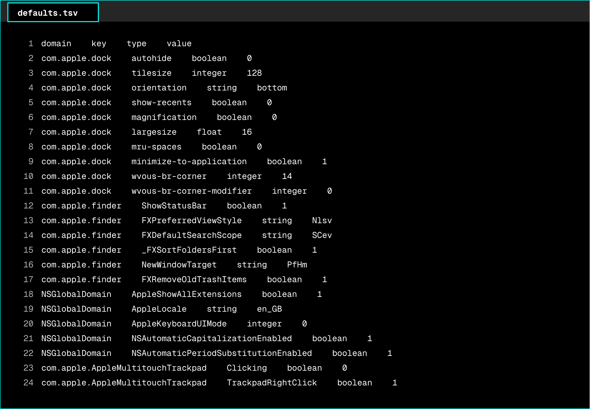

# system-defaults

This repository's operating system settings have moved to the `setup/defaults` folder of the dotfiles repository, where they are maintained together with the rest of the developer setup. Changes and issues are handled there.

[Open setup/defaults in dotfiles](https://github.com/zaccesss/dotfiles/tree/main/setup/defaults)

> [!NOTE]
> This repository is archived and read-only.

